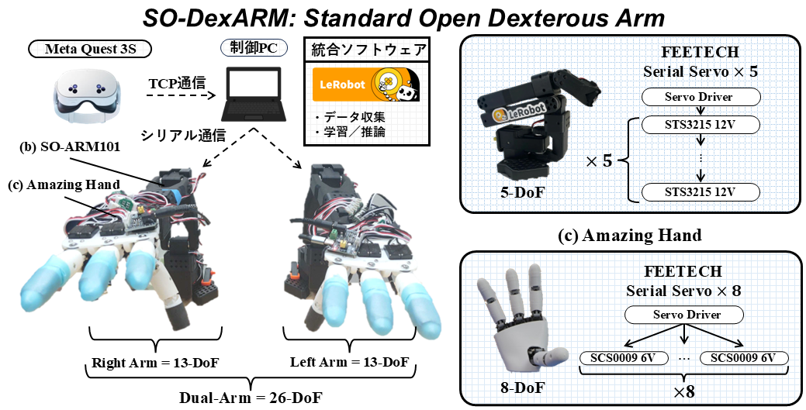

# SO-DexARM

[日本語](README.md) | **English**

SO-DexARM is an integrated system for teleoperation, data collection, training, and inference of a dual-arm robot built from AmazingHand + SO-ARM101, using hand tracking on Meta Quest 3S. This repository implements the entire pipeline on top of Hugging Face LeRobot.



## SO-DexARM Guide

This guide walks through assembling SO-DexARM, setting up the environment, calibration, teleoperation, data collection, training, and inference.

### 1. Parts List

For the parts required to build SO-DexARM, refer to the bill of materials below. It lists part names, quantities, reference prices, and purchase URLs.

[SO-DexARM Bill of Materials](https://1drv.ms/x/c/914548d97826a169/IQCNplq_oWRKTYGIElU2dYqKAYI0pj9Pnvb03ao_Z-FpBw8)

Use the following CAD data to 3D-print the parts.

- [`cad/AmazingHand/`](cad/AmazingHand/): AmazingHand CAD data
- [`cad/SO-ARM101/`](cad/SO-ARM101/): SO-ARM101 CAD data with the gripper and stopper removed

### 2. Environment Setup

The setup steps below assume Ubuntu 22.04.5 LTS.

#### 2.1 System Packages

```bash
sudo apt update
sudo apt install -y git git-lfs adb
git lfs install
```

Run the following commands to install Miniconda.

```bash
curl -O https://repo.anaconda.com/miniconda/Miniconda3-latest-Linux-x86_64.sh
bash Miniconda3-latest-Linux-x86_64.sh
```

Once the installation is complete, restart Terminator.

#### 2.2 Python Environment

Run the following commands to clone this repository and fetch Hand Tracking Streamer as a submodule.

```bash
git clone --recurse-submodules https://github.com/nii-vla-lab/SO-DexARM.git
cd SO-DexARM
```

Run the following commands to create a Python 3.10 environment and install the dependencies for SO-DexARM.

```bash
conda create -y -n lerobot python=3.10
conda activate lerobot
conda install -y ffmpeg -c conda-forge
pip install -e ".[so-dexarm]"
```

### 3. Assembly

#### 3.1 SO-ARM101

For the basic assembly steps, refer to the official [TheRobotStudio/SO-ARM100](https://github.com/TheRobotStudio/SO-ARM100).

#### 3.2 AmazingHand

As with SO-ARM101, refer to the official [AmazingHand Assembly Guide](https://raw.githubusercontent.com/pollen-robotics/AmazingHand/main/docs/AmazingHand_Assembly.pdf) for the basic assembly steps.

#### 3.3 Wiring

Map each device to its port name as follows.

| Device            | Port name                          |
| ----------------- | ---------------------------------- |
| Right SO-ARM101   | `/dev/ttyso101_amazinghand_r_arm`  |
| Left SO-ARM101    | `/dev/ttyso101_amazinghand_l_arm`  |
| Right AmazingHand | `/dev/ttyso101_amazinghand_r_hand` |
| Left AmazingHand  | `/dev/ttyso101_amazinghand_l_hand` |

### 4. Fixing Port Names

Run the following command to prepare a udev rule that fixes the port names.

```bash
cp scripts/udev/99-so-dexarm.rules.example scripts/udev/99-so-dexarm.rules
```

Connect the serial bus servo driver boards one at a time and run the following commands to check each device's information.

```bash
lerobot-find-port
udevadm info --query=property --name=/dev/ttyACM0 \
  | grep -E 'ID_VENDOR_ID|ID_MODEL_ID|ID_SERIAL_SHORT'
```

Replace the `<...>` placeholders in `scripts/udev/99-so-dexarm.rules` with the actual Vendor ID, Product ID, and serial number.

Run the following commands to apply the rule.

```bash
sudo cp scripts/udev/99-so-dexarm.rules /etc/udev/rules.d/99-so-dexarm.rules
sudo udevadm control --reload-rules
sudo udevadm trigger
```

### 5. Motor IDs and Calibration

#### 5.1 SO-ARM101 Motor IDs

Run the following commands to assign motor IDs for the right and left arms.

```bash
bash ./scripts/setup_motors.sh right
bash ./scripts/setup_motors.sh left
```

By default, motor IDs 1–5 are assigned. To assign your own motor IDs, add CLI options and run a command like the following.

```bash
bash ./scripts/setup_motors.sh right \
  --right-arm-port /dev/ttyACM0 \
  --right-arm-ids 1,2,3,4,5
```

#### 5.2 SO-ARM101 Range-of-Motion Calibration

Following the on-screen instructions, hold each joint at roughly the midpoint of its range of motion and run the commands below. Then move each joint evenly through its entire range to record its minimum and maximum limits.

```bash
lerobot-so-dexarm calibrate-arm --side right
lerobot-so-dexarm calibrate-arm --side left
```

#### 5.3 Mapping AmazingHand to Quest Landmarks

Install and launch Hand Tracking Streamer on Meta Quest 3S so that it is ready for a TCP connection, then run the commands below. At each prompt, put the AmazingHand and your own hand in the same pose: fully open (`open`), halfway (`mid`), and fully closed (`fist`).

```bash
lerobot-so-dexarm calibrate-hand \
  --side right \
  --all-poses \
  --from-hardware

lerobot-so-dexarm calibrate-hand \
  --side left \
  --all-poses \
  --from-hardware
```

To check the mapping result, run the following.

```bash
lerobot-so-dexarm map-hand --side both
```

#### 5.4 Saving the Startup Pose

Run the following command to set the startup pose used during data collection.

```bash
lerobot-so-dexarm capture-startup --side both --from-hardware
```

### 6. Meta Quest 3S and Hand Tracking Streamer

SO-DexARM uses [wengmister/hand-tracking-streamer](https://github.com/wengmister/hand-tracking-streamer) for hand tracking. In this repository, it is included as a submodule at `./scripts/hand-tracking-streamer/`.

The Quest receiver in SO-DexARM uses TCP port 8000, so run the following commands.

```bash
adb reverse tcp:8000 tcp:8000
adb reverse --list
```

Configure Hand Tracking Streamer as follows.

```text
Protocol: TCP
Host: localhost
Port: 8000
Hand side: Both Hands
```

To use wireless TCP, connect the Quest and the PC to the same network, set `Host` to the PC's IPv4 address, and set `Port` to `8000`.

### 7. Teleoperation

Run the following command to start teleoperation.

```bash
bash ./scripts/teleop.sh
```

Arm control in this system uses constrained planar IK over `shoulder_pan`, `shoulder_lift`, `elbow_flex`, and `wrist_flex`, while `wrist_roll` is held at its angle from when teleoperation started.

### 8. Camera Setup

Connect the RealSense camera and run the following command.

```bash
lerobot-find-cameras realsense
```

Run the following command to store the camera configuration in an environment variable, replacing `<CAMERA_SERIAL>` with the serial number you found.

```bash
export CAMERAS='{cam_front: {type: intelrealsense, serial_number_or_name: <CAMERA_SERIAL>, width: 640, height: 480, fps: 30}}'
```

### 9. Data Collection

Edit the task instruction, camera settings, and other values as needed, then run the following commands.

```bash
export TASK='Fold the towel.'
export CAMERAS='{cam_front: {type: intelrealsense, serial_number_or_name: <CAMERA_SERIAL>, width: 640, height: 480, fps: 30}}'

NUM_EPISODES=50 \
EPISODE_TIME_S=30 \
RESET_TIME_S=5 \
bash ./scripts/record.sh '<HUGGINGFACE_USER>/<DATASET_NAME>' --push-to-hub
```

#### 9.1 Editing a Dataset

To delete failed episodes and save the result as a separate dataset, run the following command.

```bash
bash ./scripts/edit.sh \
  --repo_id '<HUGGINGFACE_USER>/<DATASET_NAME>' \
  --new_repo_id '<HUGGINGFACE_USER>/<FILTERED_DATASET_NAME>' \
  --operation.type delete_episodes \
  --operation.episode_indices '[0, 3, 7]'
```

### 10. Training

#### 10.1 ACT

```bash
POLICY_DEVICE=cuda \
STEPS=100000 \
BATCH_SIZE=16 \
bash ./scripts/train_act.sh '<HUGGINGFACE_USER>/<DATASET_NAME>'
```

#### 10.2 SmolVLA

```bash
POLICY_DEVICE=cuda \
STEPS=20000 \
BATCH_SIZE=8 \
bash ./scripts/train_smolvla.sh '<HUGGINGFACE_USER>/<DATASET_NAME>'
```

### 11. Inference on the Real Robot

Use the same camera settings as during data collection and run the following command.

```bash
export CAMERAS='{cam_front: {type: intelrealsense, serial_number_or_name: <CAMERA_SERIAL>, width: 640, height: 480, fps: 30}}'
```

#### 11.1 ACT

```bash
bash ./scripts/eval_act.sh \
  'outputs/train/so-dexarm-act-<DATASET_NAME>/checkpoints/last/pretrained_model'
```

#### 11.2 SmolVLA

For SmolVLA, set the task string to the same one used during data collection.

```bash
TASK='Fold the towel.' \
bash ./scripts/eval_smolvla.sh \
  'outputs/train/so-dexarm-smolvla-<DATASET_NAME>/checkpoints/last/pretrained_model'
```

To change the evaluation dataset name, make sure the part after `/` starts with `eval_`.

```bash
EVAL_REPO_ID=local/eval_towel \
NUM_EPISODES=5 \
bash ./scripts/eval_act.sh '<PRETRAINED_POLICY_PATH>'
```

## Upstream projects

- [Hugging Face LeRobot](https://github.com/huggingface/lerobot)
- [TheRobotStudio SO-ARM100/SO-ARM101](https://github.com/TheRobotStudio/SO-ARM100)
- [Pollen Robotics AmazingHand](https://github.com/pollen-robotics/AmazingHand)
- [Hand Tracking Streamer](https://github.com/wengmister/hand-tracking-streamer)

## Citation

If you use SO-DexARM in your research, please cite the following paper (in Japanese).

佐藤雅紘, 三好遼, 栗田修平. VRテレオペレーションを用いた器用な操作データ収集と既存模倣学習の性能評価. 日本ロボット学会第44回学術講演会予稿集, 1G3-02, 2026.

```bibtex
@inproceedings{sato2026sodexarm,
  author    = {佐藤, 雅紘 and 三好, 遼 and 栗田, 修平},
  title     = {{VR}テレオペレーションを用いた器用な操作データ収集と既存模倣学習の性能評価},
  booktitle = {日本ロボット学会第44回学術講演会予稿集},
  note      = {1G3-02},
  year      = {2026},
  month     = sep,
}
```
